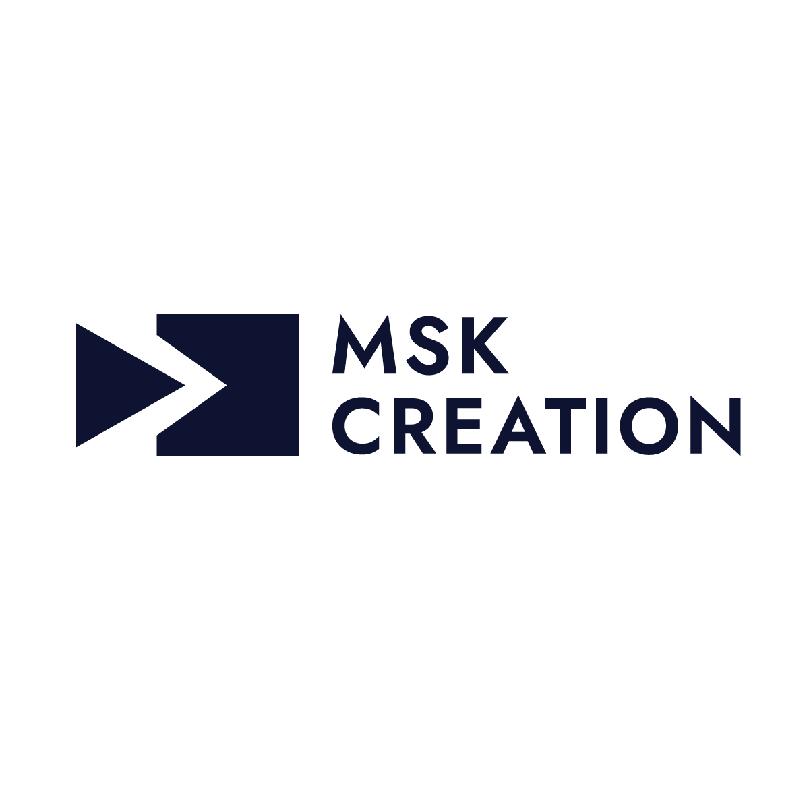

<div align="center">

<table>
  <tr>
    <td bgcolor="#0D1330" width="720" align="center" style="border-radius: 12px; padding: 48px 40px;">
      <br />
      
      <br /><br />
      <p>
        <strong><font color="#F5F3EF" size="4">MSK Création</font></strong>
      </p>
      <p>
        <font color="#8A93A6">Site vitrine · Bamako · FR / EN</font>
      </p>
      <p>
        <font color="#1D73BC">React Router SSR · Tailwind v4 · daisyUI v5</font>
      </p>
      <br />
    </td>
  </tr>
</table>

<br />

**Fidélité Figma · Charte graphique v3 · Contenu SSR · Assets pipeline**

[Guide projet](./docs/architecture/PROJECT_GUIDE.md)
·
[Documentation](./docs/README.md)
·
[Charte](./docs/brand/README.md)
·
[Agents](./AGENTS.md)

</div>

---

## Qu’est-ce que ce dépôt ?

Site vitrine de **MSK Création**, reproduit depuis la maquette Figma validée, avec :

- rendu **SSR** (HTML indexable dès la première réponse) ;
- **deux locales** (`/fr`, `/en`) sans mélange de copy ;
- séparation stricte **UI ≠ content ≠ data** ;
- assets Figma uniquement, servis via `assetUrl()` (local puis CDN).

| | |
|---|---|
| **Produit** | Site vitrine MSK Création |
| **Figma** | [MSK-MAQUETTE](https://www.figma.com/design/wn9ZMeW9YwaF3PE8Wqa2WS/MSK-MAQUETTE) |
| **Charte** | [`docs/brand/`](./docs/brand/) (v3 · 2026-09-25) |
| **Prod cible** | `https://www.mskcreation.net` |
| **Branche de travail** | `dev` (sauf indication contraire) |

---

## Démarrage rapide

```bash
# Prérequis : Node 22+ recommandé
cp .env.example .env
npm install
npm run dev
```

Ouvrir [http://localhost:5173](http://localhost:5173) → redirect vers `/fr`.

| Script | Rôle |
|--------|------|
| `npm run dev` | Serveur de développement |
| `npm run build` | Build SSR production |
| `npm start` | Servir le build |
| `npm run typecheck` | Typegen React Router + `tsc` |
| `npm run check` | typecheck + copy + origin |
| `npm run check:copy` | Interdit `—` / `–` dans `app/content` et `app/data` |
| `npm run check:origin` | Gate `VITE_SITE_ORIGIN` (strict en prod) |
| `npm run check:images` | Images `public/` > 500 Ko |
| `npm run assets:compress:priority` | WebP + AVIF (hero, works, team, …) |
| `npm run assets:compress` | Tous les rasters sous `public/assets` |

---

## Stack

| Couche | Choix |
|--------|--------|
| Framework | React Router **8.x** Framework Mode (`ssr: true`) |
| UI | React 19 + TypeScript |
| Styles | Tailwind CSS **v4** + daisyUI **v5** (thème `msk`) |
| Icônes | Lucide React (interactions) |
| Email contact | Resend (opt-in via env) |
| Images | PNG Figma sources + dérivés WebP/AVIF (`OptimizedImg`) |
| Hosting | Vercel (preview / prod) |

---

## Architecture en une page

```
UI  ≠  content  ≠  data  ≠  traductions
```

| Couche | Où | Contient |
|--------|-----|----------|
| **UI** | `app/components/` | Sections, layout, primitives. Zéro copy hardcodée. |
| **Content** | `app/content/fr\|en/` | Textes, meta, alts, labels UI. |
| **Data** | `app/data/` | Slugs, chemins assets, filtres, ordre deck. |
| **Routes** | `app/routes.ts` + `app/routes/` | Déclaration + loaders / actions / meta. |
| **Server** | `app/server/` | Loaders métier, email, rate-limit, API. |
| **Assets** | `public/assets/` | Photos / logos runtime. Toujours via `assetUrl()`. |

**Guide détaillé :** [`docs/architecture/PROJECT_GUIDE.md`](./docs/architecture/PROJECT_GUIDE.md)
(routing, pages, renommages, images, composants, checklists).

---

## Routes

| Path | Rôle |
|------|------|
| `/` | Redirect → `/fr` |
| `/fr`, `/en` | Home (sections Figma) |
| `/fr/travaux/:slug` | Fiche projet FR |
| `/en/projects/:slug` | Fiche projet EN |
| `/robots.txt` | Crawl + lien sitemap |
| `/sitemap.xml` | Home + fiches FR/EN (deck 7) |

Helpers de path : `app/i18n/paths.ts` (`homePath`, `projectPath`, …).

---

## Brand (aperçu)

| Token | Hex | Usage |
|-------|-----|--------|
| Encre | `#0D1330` | Fonds sombres, texte fort |
| Bleu | `#1D73BC` | Logo couleur, CTA, accents |
| Corail | `#FF5A3C` | Accent secondaire (≤ 10 %) |
| Craie | `#F5F3EF` | Fonds clairs |

Détail palette, logos, typos : [`docs/brand/README.md`](./docs/brand/README.md).

---

## Variables d’environnement

Voir [`.env.example`](./.env.example).

| Variable | Rôle |
|----------|------|
| `VITE_SITE_ORIGIN` | **Obligatoire en prod** : canonical, hreflang, OG, JSON-LD, sitemap |
| `VITE_ASSET_BASE_URL` | Préfixe CDN (vide = fichiers locaux `/assets/...`) |
| `CONTACT_EMAIL_ENABLED` | `1` pour activer Resend |
| `RESEND_API_KEY` | Clé dédiée (jamais dans git) |
| `CONTACT_EMAIL_FROM` / `CONTACT_EMAIL_TO` | Expéditeur / destinataire |

Sans `VITE_SITE_ORIGIN` https en prod, les URL SEO absolues restent incorrectes.

---

## Documentation

| Document | Contenu |
|----------|---------|
| [**Guide projet**](./docs/architecture/PROJECT_GUIDE.md) | Comment on a construit le site (le mode d’emploi) |
| [Index docs](./docs/README.md) | Carte de toute la documentation |
| [AGENTS.md](./AGENTS.md) | Règles pour agents / contributeurs |
| [CONSTRAINTS.md](./CONSTRAINTS.md) | Barre qualité non négociable |
| [Décisions design](./docs/design/DESIGN_DECISIONS.md) | Choix validés |
| [Inventaire assets](./docs/design/ASSETS_INVENTORY.md) | État des médias |
| [Pipeline images](./docs/quality/IMAGE_PIPELINE.md) | Compress / WebP / AVIF |
| [Contact Resend](./docs/design/CONTACT_BACKEND.md) | Backend formulaire |
| [Go-live](./docs/ops/PROD_GO_LIVE_CHECKLIST.md) | Checklist prod |

---

## Règle d’or

> Le design Figma et la charte v3 sont les sources de vérité.  
> Ne jamais inventer section, texte, image, animation, couleur ou breakpoint  
> sans validation écrite dans `FIGMA_OPEN_QUESTIONS.md` ou `DESIGN_DECISIONS.md`.

---

<div align="center">

<br />



<br />

<sub>MSK Création · Bamako · ACI 2000</sub>

</div>
